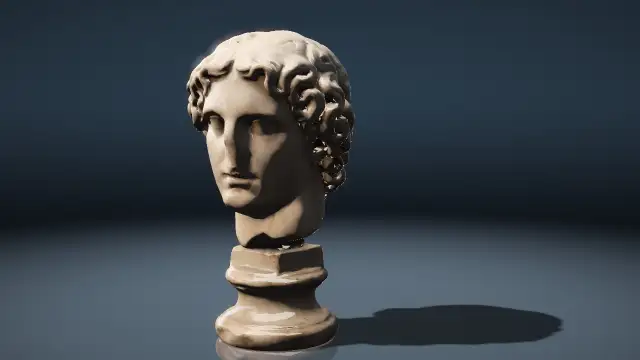
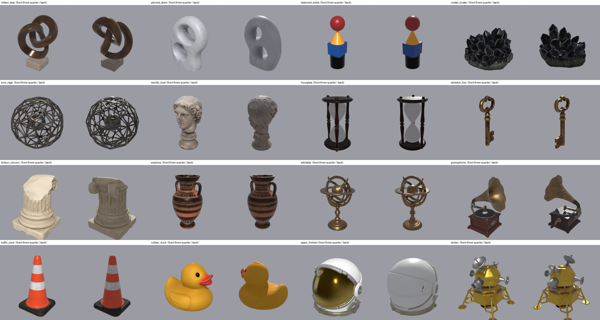

# touchdesigner-harness



**Let Claude Code build TouchDesigner networks with you: in your live session, step by step, and with every step looked at, checked and saved to git.**

The picture above shows one second from each of eighteen scenes. They belong to the largest thing built with the harness so far, an audio-reactive scene engine that cuts between them in time with a music track. The engine is in this repository with everything it needs to run. The project page at **[billmoore.ai/touchdesigner](https://billmoore.ai/touchdesigner/)** has a film of it with sound. The harness is made by [Bill Moore](https://billmoore.ai).

You describe an idea ("an inward spiral whose colour drifts"). Claude builds a small piece of the network, **captures the output and looks at it**, compares it with what you asked for, and decides the next step. It runs real checks, such as "not black", "actually moving" and "inside the frame budget", before it calls anything done. Each version worth keeping is committed as a `.tox` plus a readable text snapshot of the network, so you can see in a diff what changed.

It isn't another MCP server. It's the harness around one: rules, skills, a small in-TD toolkit and checks. It sits on top of [touchdesigner-mcp](https://github.com/8beeeaaat/touchdesigner-mcp) or Derivative's official [TDMCP](https://github.com/TouchDesigner/TDMCP).

## What you need

- **TouchDesigner 2025.33230 or newer.** A Non-Commercial license is fine (outputs are capped at 1280×1280).
- **[Claude Code](https://code.claude.com/docs)**
- **Windows or macOS** with a GPU. TD doesn't run on Linux.
- **git, and Node.js 24** for touchdesigner-mcp (22.18+ and 26+ also satisfy it; 24 is the tested one). The install below checks for both and gives you the download link if one is missing or too old.

## Install

Paste this line into Claude Code, in any folder:

```
Set up touchdesigner-harness with me by following https://billmoore.ai/touchdesigner/install.md
```

Claude Code clones this repository and follows [docs/INSTALL.md](docs/INSTALL.md) with you: it checks what is installed, downloads touchdesigner-mcp 2.2.0, and gives you the few clicks that have to happen in TouchDesigner's window, one at a time. It asks before it changes anything outside the clone folder, and it ends by having you start Claude Code in that folder and say *"continue setup"*. The MCP server it registers lets Claude Code run Python inside whatever project is open in TouchDesigner, so the install makes a new lab project: do not use a show file.

To do it by hand, or to use TDMCP, follow [docs/SETUP.md](docs/SETUP.md).

## What a session looks like

*Condensed from the real `feedback_drift` session; Claude's wording is paraphrased.*

> **You:** new experiment: an inward spiral whose colour slowly drifts

Claude names it `feedback_drift`. (It first tried `feedback-drift`; TD rejected the hyphen, which is why slugs are snake_case now.) It creates `experiments/feedback_drift/` and a `/project1/feedback_drift` COMP with a cook driver, writes your intent into `NOTES.md`, and commits.

> **You:** go

Claude wires noise × a hue-drifting ramp into a feedback loop, captures `out1` and **opens the PNG**: *"Hue drift works, but it's soft fog: no visible trails."* It adds a Level TOP after the noise to cut it into isolated blooms and captures again: *"Distinct blooms with trails, but the trails radiate outward."* It sets the feedback scale below 1 and adds rotation: *"Inward spiral, hue drifting. Matches the intent."* Every step is logged in `NOTES.md` with its capture.

> **You:** is it done?

Claude runs `td-verify`. The first run is `PENDING`, because the motion and cook-budget checks need two samples; the second is `PASS`: no errors, not black, moving, under 12 ms. Then `td-snapshot` saves the `.tox`, writes `snapshot/network.json` and a hero frame, and commits. `git diff` shows exactly which operators and parameters changed.

## The scene engine

The scene engine plays a music track and cuts between eighteen scenes in time with it. Every scene was built through the harness, and the picture is rendered live.

- **The hub** ([`experiments/sw_hub/`](experiments/sw_hub/)) plays a track and publishes what the music is doing on every frame: the loudness of each stem, beats, bars, sections and drum hits. The analysis is done ahead of time (stem separation, then beat, section and drum-hit detection), and [`tools/audiofeed`](tools/audiofeed/) bakes its result into the feed file the hub reads. The feeds for the two tracks in the asset pack are included.
- **Eighteen scenes** (`experiments/sc_*/`) each read the hub and apply a different technique. Each scene has several takes (another camera, subject, palette or mode), 169 in all, so a scene looks different each time it returns.
- **The cutter** ([`experiments/sw_cut/`](experiments/sw_cut/)) switches scenes on beat lines, and can add a treatment, a transition or a second scene layered over the first.
- **The control panel** ([`experiments/sw_panel/`](experiments/sw_panel/)) puts the scene, take, treatment, track and volume on one page, so nobody has to read the network.

### Run it

The install offers to build it as its last step. At any later time, ask Claude to *"build the scene engine with experiments/sw_hub/build_all.py"*, or run this in TouchDesigner's Textport:

```python
g = {'op': op, 'td': td, 'absTime': absTime, 'project': project}
exec(open(project.folder + '/experiments/sw_hub/build_all.py', encoding='utf-8').read(), g)
g['start']()
```

It builds the hub, the scenes, the cutter and the panel, then opens the panel beside the output. The timeline must be playing while it builds. On the panel, raise **Speaker Volume** to hear the track (it starts at 0), or turn **Cut With The Music** off to choose a scene and step through its takes with **Next Take**.

### The scenes

The [preset gallery](docs/GALLERY.md) shows every take of every scene.

| Scene | Technique | Takes |
|---|---|---|
| [Monitor showing itself](docs/GALLERY.md#sc_droste_crt) | A monitor on a 3D desk shows the camera's previous frame, so video feedback builds a tunnel of monitors. | 9 |
| [Exploded technical drawing](docs/GALLERY.md#sc_exploded_view) | 3D models are drawn as engineering line art and come apart, with live dimension lines and labels around them. | 10 |
| [Melting poster datamosh](docs/GALLERY.md#sc_flow_mosh) | A deliberate video-compression glitch: a clean picture flashes, then its own motion drags blocks of the last frame around. | 7 |
| [Ink in water](docs/GALLERY.md#sc_fluid_ink) | A 2D fluid simulation in shaders, where words and model silhouettes are laid down as inks over paper. | 10 |
| [Pictures made of type](docs/GALLERY.md#sc_glyph_render) | A 3D scene is redrawn in pure black and white from the letters of one bitmap font. | 8 |
| [Letter architecture](docs/GALLERY.md#sc_kifs_office) | One ray-marched shader draws an endless folded fractal of steel blocks with lettering embossed into its surfaces. | 7 |
| [Kinetic type machine](docs/GALLERY.md#sc_kinetic_type) | Moving poster typography: every letter is its own small rectangle cut from a font sheet and animated by a shader. | 12 |
| [Fog and shadow type](docs/GALLERY.md#sc_light_gobo) | A dark, foggy room where patterned light and the shadows of objects hang as solid shafts in the air. | 11 |
| [Paper storm](docs/GALLERY.md#sc_paper_storm) | Thousands of copies of a printed sheet are placed and turned by one shader that arranges them into formations. | 8 |
| [Slime mould](docs/GALLERY.md#sc_physarum) | A slime mould simulation: about 230,000 agents follow each other's trails and grow veins over objects and phrases. | 11 |
| [Point cloud shapeshifter](docs/GALLERY.md#sc_point_morph) | A cloud of about 124,000 points, sampled from 3D models and lettering, streams from one shape into the next. | 8 |
| [Living rubber stamp](docs/GALLERY.md#sc_rd_stamp) | Stamped phrases feed a reaction-diffusion simulation, so the letters grow coral-like tendrils and beads. | 7 |
| [Misregistered print shop](docs/GALLERY.md#sc_riso_press) | A 3D object is split into spot-colour plates, each screened into dots or lines and overprinted out of register. | 14 |
| [Scan line video synth](docs/GALLERY.md#sc_rutt_etra) | A 1970s-style video synthesizer: a picture is redrawn as glowing scan lines in 3D, displaced by its brightness. | 10 |
| [Shatter and reassemble](docs/GALLERY.md#sc_shatter) | 3D models and phrases are pre-cut into rigid shards that burst apart and pull back together exactly. | 10 |
| [Spectrogram terrain](docs/GALLERY.md#sc_spectral_terrain) | The last few seconds of the sound spectrum become a landscape of glowing ridge lines receding from the viewer. | 8 |
| [Time-sliced objects](docs/GALLERY.md#sc_time_slab) | A slit-scan effect: every part of the picture shows a different moment of a spinning 3D object. | 8 |
| [Oscilloscope beam drawings](docs/GALLERY.md#sc_vector_scope) | A simulated oscilloscope: one glowing beam traces word outlines, 3D wireframes and waveforms with fading phosphor afterglow. | 11 |

A scene can also take another scene's picture as its input and work on that in place of its own subject. Set the scene's **Input** parameter to the other scene's output.

### The asset pack



The scenes draw their 3D models, typefaces, lettering and music from [`assets/`](assets/), a pack that ships with the repository. It holds sixteen objects (abstract sculptures, archetypal objects, and objects from the past, present and future), three printed sheets, lettering and two instrumental tracks with their analysis, all generated for this project, and three open-licence typefaces. [`assets/README.md`](assets/README.md) lists the contents and how each part was made.

A scene's words, model names and tuning are one table at the top of its `build.py`. A pack can replace them, and you can point the engine at a pack of your own, without changing a scene's code. With no pack at all, each scene falls back to TouchDesigner's bundled teapot and default typeface, and the hub plays TouchDesigner's bundled sample track.

The samples on the project page were recorded with a different, private pack, so they show other objects and words than this repository gives you.

More preset and asset packs are planned for future releases.

## Smaller examples

Three single experiments came before the scene engine. They are the quickest way to see what one experiment folder holds: its `.tox`, `checks.json`, a readable `snapshot/network.json`, a hero frame, and a `NOTES.md` that logs every step, including the ones that did not work. To try one, drag its `.tox` into your lab project.

| | |
|--|--|
|  | **[`audio_particles`](experiments/audio_particles/)**: a word made of 30,000 POP points that erupts into smoke on the beat and re-forms between beats. The COMP has a **Text** parameter, and **Music Folder** and **Track** parameters for your own audio. |
|  | **[`sdf_sculpture`](experiments/sdf_sculpture/)**: a raymarched liquid sculpture written in a few lines of [Shader Park](https://github.com/shader-park/shader-park-core) JavaScript, compiled headless to a GLSL TOP shader by [`tools/shaderpark`](tools/shaderpark/). |
|  | **[`feedback_drift`](experiments/feedback_drift/)**: noise blooms tinted by a hue-drifting ramp, spiralling inward through a 16-bit float feedback loop. Its `NOTES.md` shows the build, look and adjust loop step by step. |

## What's inside

| | |
|--|--|
| [`AGENTS.md`](AGENTS.md) | The rules Claude follows around a live TD session. Several of them came from traps hit on a real install. |
| [`.claude/skills/`](.claude/skills/) | `td-setup` (first-time setup), `td-connect`, `td-new-experiment`, `td-sketch` (the build → look → adjust loop), `td-glsl`, `td-verify`, `td-snapshot` |
| [`td/tdh/`](td/tdh/) | The in-TD toolkit (Python 3.11 + numpy). It handles the error sweep, PNG capture, motion and stall detection, the cook budget, `checks.json` and text snapshots. It observes; it never builds. |
| Controls | You never have to read the network to change something. As it builds, Claude puts the words, amounts and choices on the experiment as labelled controls, a check fails if any control does nothing, and `tdh.show(...)` opens the controls beside the output so you can move a slider and watch. |
| [`experiments/`](experiments/) | One folder per idea, and `_template/` to start from. The scene engine is the `sw_*` and `sc_*` folders. |
| [`assets/`](assets/) | The asset pack the scene engine uses |
| [`tools/`](tools/) | Offline tools: the feed baker, model conversion, the gallery and the asset pack's generators |
| [`docs/`](docs/) | [INSTALL](docs/INSTALL.md) (the walk-through Claude Code follows) · [SETUP](docs/SETUP.md) (the same by hand) · [TRANSPORTS](docs/TRANSPORTS.md) (servers and tool names) · [REMOTE](docs/REMOTE.md) (phone, other machines, GPU VMs) · [KNOWN-ISSUES](docs/KNOWN-ISSUES.md) · [RESEARCH](docs/RESEARCH.md) (what else exists) |

## Status and limits

- **This is version 0.1, and it is early.** One person and one Windows machine have built everything here with it.
- **Verified on:** Windows, TD 2025.33230, touchdesigner-mcp 2.2.0.
  - **It has not been tested on macOS yet.**
  - **TDMCP** works for create and wire. TD crashed once while TDMCP was setting an expression, so the rules route expressions through Python for now. Its first full run is still pending.
- **The scene engine has been built and run on one machine.** Its builder has not yet been tried from a fresh clone on a second machine.
- **The analysis step that makes a feed for a new track is not in the repository yet.** The engine plays the two tracks in the asset pack and TouchDesigner's sample track; a track of your own needs a feed baked from an analysis made elsewhere.
- **Claude judges how things look from downscaled stills.** It can't watch the output as video. The `moving` check confirms motion numerically, not aesthetically.
- **The agent can run arbitrary Python inside your TD session.** The rules keep it inside the experiment COMP and away from saving the whole project, but use a lab project, not a show file.
- `./check.sh` (lint plus unit tests against a fake `td` module) runs in CI. Live checks need TouchDesigner, so they run on your machine.

## License

This repository is under the MIT license. The typefaces in `assets/fonts/` are under the SIL Open Font License, and their licence texts are beside them. touchdesigner-mcp (MIT) and TDMCP (Derivative's Shared Use License) are separate projects with their own licenses, and neither is included here.
