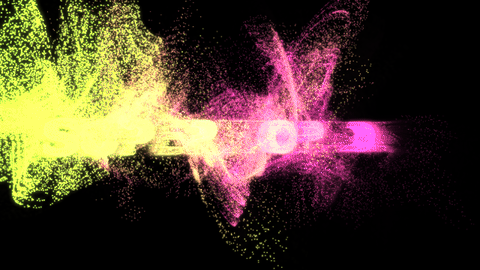
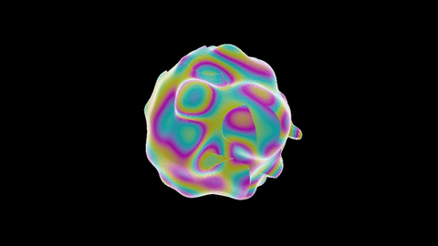
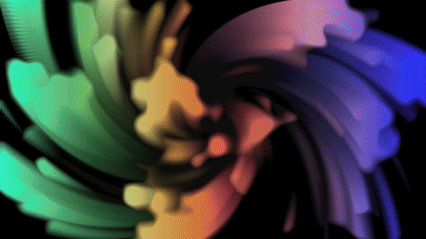

# touchdesigner-harness



**Let Claude Code build TouchDesigner networks with you: in your live session, step by step, and with every step looked at, checked and saved to git.**

**Project page, with the examples in motion: [billmoore.ai/touchdesigner](https://billmoore.ai/touchdesigner/).** The harness is made by [Bill Moore](https://billmoore.ai).

You describe an idea ("an inward spiral whose colour drifts"). Claude builds a small piece of the network, **captures the output and looks at it**, compares it with what you asked for, and decides the next step. It runs real checks, such as "not black", "actually moving" and "inside the frame budget", before it calls anything done. Each version worth keeping is committed as a `.tox` plus a readable text snapshot of the network, so you can see in a diff what changed.

It isn't another MCP server. It's the harness around one: rules, skills, a small in-TD toolkit and checks. It sits on top of [touchdesigner-mcp](https://github.com/8beeeaaat/touchdesigner-mcp) or Derivative's official [TDMCP](https://github.com/TouchDesigner/TDMCP).

## What you need

- **TouchDesigner 2025.33230 or newer.** A Non-Commercial license is fine (outputs are capped at 1280×1280).
- **[Claude Code](https://code.claude.com/docs)**
- **Windows or macOS** with a GPU. TD doesn't run on Linux.
- **Node.js 24** for touchdesigner-mcp, and git.

## 5-minute setup

This is the path that has been tested end to end. Full details, plus TDMCP, are in [docs/SETUP.md](docs/SETUP.md).

1. **Clone:**

   ```bash
   git clone https://github.com/chickensintrees/touchdesigner-harness.git
   cd touchdesigner-harness
   ```

2. **Make your lab project.** In TouchDesigner, save a new project as `lab.toe` in the repo folder. It stays out of git.
3. **Install touchdesigner-mcp 2.2.0** by following its [installation guide](https://github.com/8beeeaaat/touchdesigner-mcp/blob/main/docs/installation.md) for Claude Code. Import `mcp_webserver_base.tox` from the same release into `/project1`.
4. **Fix the one trap:** set that component's **External .tox** parameter to the *absolute* path of `mcp_webserver_base.tox`. The relative default breaks once the project lives in the repo. Save with Ctrl+S.
5. **Start Claude Code** in the repo and say: *"connect to TouchDesigner"*.

If step 5 reports your TD build and "0 pre-existing errors", you're ready.

## What a session looks like

*Condensed from the real `feedback_drift` session; Claude's wording is paraphrased.*

> **You:** new experiment: an inward spiral whose colour slowly drifts

Claude names it `feedback_drift`. (It first tried `feedback-drift`; TD rejected the hyphen, which is why slugs are snake_case now.) It creates `experiments/feedback_drift/` and a `/project1/feedback_drift` COMP with a cook driver, writes your intent into `NOTES.md`, and commits.

> **You:** go

Claude wires noise × a hue-drifting ramp into a feedback loop, captures `out1` and **opens the PNG**: *"Hue drift works, but it's soft fog: no visible trails."* It adds a Level TOP after the noise to cut it into isolated blooms and captures again: *"Distinct blooms with trails, but the trails radiate outward."* It sets the feedback scale below 1 and adds rotation: *"Inward spiral, hue drifting. Matches the intent."* Every step is logged in `NOTES.md` with its capture.

> **You:** is it done?

Claude runs `td-verify`. The first run is `PENDING`, because the motion and cook-budget checks need two samples; the second is `PASS`: no errors, not black, moving, under 12 ms. Then `td-snapshot` saves the `.tox`, writes `snapshot/network.json` and a hero frame, and commits. `git diff` shows exactly which operators and parameters changed.

## The examples

Three experiments, each built entirely through this harness. Each folder holds its `.tox`, `checks.json`, a readable `snapshot/network.json`, a hero frame, and a `NOTES.md` that logs every step, including the ones that didn't work. To try one, drag its `.tox` into your lab project.

| | |
|--|--|
|  | **[`audio_particles`](experiments/audio_particles/)**: a word made of 30,000 POP points that erupts into smoke on the beat and re-forms between beats. The COMP has a **Text** parameter (default `SUPERWORLD!`), and **Music Folder** / **Track** parameters for your own audio; blank, it uses TD's bundled sample track. Bursts follow the level relative to its own running average, so they land on the beats of loud and quiet tracks alike. It plays through an Audio Device Out. |
|  | **[`sdf_sculpture`](experiments/sdf_sculpture/)**: a raymarched liquid sculpture written in a few lines of [Shader Park](https://github.com/shader-park/shader-park-core) JavaScript, compiled headless to a GLSL TOP shader by [`tools/shaderpark`](tools/shaderpark/), at about 1.2 ms a frame at 1280×720. |
|  | **[`feedback_drift`](experiments/feedback_drift/)**: noise blooms tinted by a hue-drifting ramp, spiralling inward through a 16-bit float feedback loop. The first experiment; its `NOTES.md` shows the build-look-adjust loop step by step. |

## Gallery: an example project

The harness was used to build an audio-reactive scene engine in one TouchDesigner project. A hub plays a music track and publishes what the music is doing on every frame. Eighteen scenes each read the hub and apply a different technique, and a cutter switches between them on beat lines. Every scene has between 7 and 14 takes, which are the same network with another camera, subject, palette or mode.

- The [preset gallery](docs/GALLERY.md) shows every scene and every take.
- The project page at [billmoore.ai/touchdesigner](https://billmoore.ai/touchdesigner/) has the samples in motion.

The source of these scenes is not in this repository yet. They still load 3D models, fonts and music from local folders, so they would not run on another machine. They will be added once those paths are portable.

## What's inside

| | |
|--|--|
| [`AGENTS.md`](AGENTS.md) | The rules Claude follows around a live TD session. Several of them came from traps hit on a real install. |
| [`.claude/skills/`](.claude/skills/) | `td-connect`, `td-new-experiment`, `td-sketch` (the build → look → adjust loop), `td-glsl`, `td-verify`, `td-snapshot` |
| [`td/tdh/`](td/tdh/) | The in-TD toolkit (Python 3.11 + numpy). It handles the error sweep, PNG capture, motion and stall detection, the cook budget, `checks.json` and text snapshots. It observes; it never builds. |
| Controls | You never have to read the network to change something. As it builds, Claude puts the words, amounts and choices on the experiment as labelled controls, a check fails if any control does nothing, and `tdh.show(...)` opens the controls beside the output so you can move a slider and watch. |
| [`experiments/`](experiments/) | One folder per idea, and `_template/` to start from |
| [`docs/`](docs/) | [SETUP](docs/SETUP.md) · [TRANSPORTS](docs/TRANSPORTS.md) (servers and tool names) · [REMOTE](docs/REMOTE.md) (phone, other machines, GPU VMs) · [KNOWN-ISSUES](docs/KNOWN-ISSUES.md) · [RESEARCH](docs/RESEARCH.md) (what else exists) |

## Status and limits

- **v0.1, early.** One person and one Windows machine have built three experiments with it.
- **Verified on:** Windows, TD 2025.33230, touchdesigner-mcp 2.2.0.
  - **Not yet on macOS.**
  - **TDMCP** works for create and wire. TD crashed once while TDMCP was setting an expression, so the rules route expressions through Python for now. Its first full run is still pending.
- **Claude judges how things look from downscaled stills.** It can't watch the output as video. The `moving` check confirms motion numerically, not aesthetically.
- **The agent can run arbitrary Python inside your TD session.** The rules keep it inside the experiment COMP and away from saving the whole project, but use a lab project, not a show file.
- `./check.sh` (lint plus unit tests against a fake `td` module) runs in CI. Live checks need TouchDesigner, so they run on your machine.

## License

MIT, for this repo. touchdesigner-mcp (MIT) and TDMCP (Derivative's Shared Use License) are separate projects with their own licenses, and neither is included here.

## Licence

The code in this repository is released under the MIT licence (see `LICENSE`). The images in `docs/media/gallery/` show SUPERWORLD! artwork, models and lettering, which are not covered by that licence and remain the property of Bill Moore.
