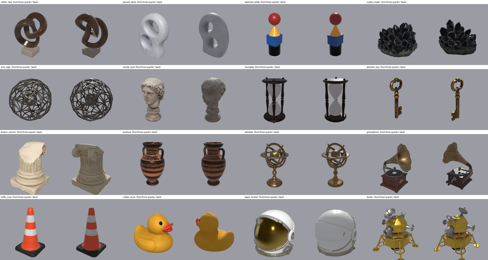

# The asset pack

This folder is the asset pack that ships with the repository. The scene engine looks here for its 3D models, fonts, lettering and music. Everything in it was generated for this project.

## What is in it

| Folder | Contents | How it was made |
|---|---|---|
| `models/` | Sixteen objects: five abstract sculptures, four archetypal objects, three from the past, two from the present and two from the future. Three flat printed sheets. Each model has a `model.obj`, a `basecolor.png` and an `info.json` with its prompt. | Each object started as a concept image from a text prompt (Krea 2 Turbo) and was turned into a textured mesh by TRELLIS.2. The prompts are in `tools/assets/objects.json`. |
| `sheets/` | The three flat sheets as images: a star chart, a blueprint and a ticket. | Generated as images from text prompts. |
| `fonts/` | Archivo Black, Barlow Condensed Bold and IBM Plex Mono Medium, each with its licence text. | Open Font License typefaces. |
| `art/` | Two pieces of lettering as large PNG files. | Rendered from the fonts by `tools/assets/make_art.py`. |
| `music/` | Two instrumental tracks: `drive` (fast, four-on-the-floor) and `drift` (slow, sparse). | Generated from text prompts with the ElevenLabs Music API by `tools/assets/make_music.py`. |
| `feeds/` | The analysis of each track: the loudness of each stem, beats, bars, sections and drum hits, looked up by track time. | Stem separation and analysis, then `tools/audiofeed/bake_feed.py`. |
| `aliases.json` | A table that names a stand-in for a file the pack does not hold. | Written by `tools/assets/make_aliases.py`. |

More preset and asset packs are planned for future releases.

## How the scenes use it

A scene asks for an asset by name, for example the model `amphora`, the sheet `blueprint` or the lettering `art/mark_rgb.png`. Each scene keeps its words, the names of its models and the tuning for each model in one table at the top of its `build.py`, and those defaults are written for this pack.

`aliases.json` lets a pack answer a name with a different file. This pack uses it once: the scenes ask for a typeface called `chicago`, and the pack answers with IBM Plex Mono.

If a file is missing and has no alias, the scene falls back to what TouchDesigner ships with: its bundled teapot for a model, its default typeface for a font, and its own sample track for music.

## Replacing a scene's words and models

A pack can change what a scene shows without any change to the scene's code.

- **`scenes/<scene>/words.json`** replaces entries of that scene's table of defaults. Each top-level name in the file replaces the entry of the same name, and must be the same kind of value (a list for a list). Names the scene does not have are ignored. The file is read when the scene is built, so rebuild the scene after changing it.
- **`scenes/<scene>/<file>`** replaces a data file the scene keeps in its own folder, for example the beam paths that `sc_vector_scope` bakes from models and words.

## Using your own assets

There are three ways to use other files.

- **Replace or add files here.** A folder under `models/` with the name a scene asks for is used in place of the alias. A track appears in the hub when it has both `music/<name>.wav` (or `.mp3`) and `feeds/<name>/feed.chan` with `feed.json`.
- **Keep a separate pack.** Put the path of another folder with the same layout on the first line of a file named `assets.local.txt` in the repository root. That file is ignored by git. The engine then uses that folder instead of this one, and its tracks are added to the hub's list.
- **Set `TDH_ASSETS`.** Setting this environment variable to a folder before starting TouchDesigner does the same for one session.

To see a single scene with no assets at all, set that scene's `Assets` parameter to an empty folder.

To convert your own GLB models into the format used here, run `tools/models/convert_models.py` with Blender. It joins each model into one mesh, centres it, scales its longest side to 1 unit and extracts its colour image.
