# Preset gallery

Every picture here was captured from the running network, driven by the same music track.
A **preset** is a scene, one of its takes, and optionally a treatment: 18 scenes, 169 takes, 10 treatments.

To call one up by hand, open the `sw_cut` component's **Manual** page, turn **Cut With The Music** off, and set Scene, Take, Seed and Treatment. With it on, the cutter picks presets itself, in time with the music.

| Scene | Technique | Takes |
|---|---|---|
| [Monitor showing itself](#sc_droste_crt) | A 3D desk of found objects with a monitor whose screen displays the previous frame of the same camera, so real video feedback builds a tunnel of monitors inside monitors. | 9 |
| [Exploded technical drawing](#sc_exploded_view) | 3D models of unexplained objects are drawn as engineering line art: a shader traces outlines and creases, the objects come apart, and live dimension lines and labels sit around them. | 10 |
| [Melting poster datamosh](#sc_flow_mosh) | A deliberate video-compression glitch: a clean picture flashes for an instant, then its own hidden motion drags blocks of the last frame around until the next clean flash. | 7 |
| [Ink in water](#sc_fluid_ink) | A two-dimensional fluid simulation in shaders, where words, pages of small print and 3D model silhouettes are laid down as three inks and lit like a wet surface over paper. | 10 |
| [Pictures made of type](#sc_glyph_render) | A 3D scene is redrawn from letters of one bitmap font in pure black and white, with brightness deciding how each letter is inked while the letters spell running sentences. | 8 |
| [Letter architecture](#sc_kifs_office) | A single ray-marched shader draws an endless folded fractal lattice of steel blocks, with sign lettering embossed into its surfaces as real relief that catches light. | 7 |
| [Kinetic type machine](#sc_kinetic_type) | Moving poster typography in flat colours: every letter, rule and bar is its own small rectangle cut from a font sheet, placed and animated by a shader. | 12 |
| [Fog and shadow type](#sc_light_gobo) | A dark room full of drifting fog, lit by a projector, fluorescent tubes and a lamp, where patterned light and the shadows of objects hang as solid shafts in the air. | 11 |
| [Paper storm](#sc_paper_storm) | Thousands of copies of a printed sheet of paper, plus a couple of hundred objects, are each placed and turned by one shader that arranges them into different formations. | 8 |
| [Slime mould](#sc_physarum) | A slime mould simulation: about 230,000 tiny agents follow each other's trails and grow veins over turning 3D objects, printed sheets and short phrases. | 11 |
| [Point cloud shapeshifter](#sc_point_morph) | One cloud of about 124,000 coloured points, sampled from the surfaces of 3D models and lettering, that streams from one shape into the next on a noise wind. | 8 |
| [Living rubber stamp](#sc_rd_stamp) | Stamped phrases feed a reaction-diffusion simulation, so the letters grow coral-like tendrils and beads, lit as raised gold, red enamel or black tar ink on printed paper sheets. | 7 |
| [Misregistered print shop](#sc_riso_press) | A 3D object lit by red, green and blue lights is split into spot-colour plates, each screened into dots, lines or grain and overprinted out of register on moving paper. | 14 |
| [Scan line video synth](#sc_rutt_etra) | A 1970s-style analogue video synthesizer: a hidden source picture is redrawn as glowing scan lines in 3D, each line pushed up and back by the brightness beneath it. | 10 |
| [Shatter and reassemble](#sc_shatter) | 3D models and extruded phrases are pre-cut into rigid shards, and a shader bursts them apart and pulls them back together exactly, like footage run backwards. | 10 |
| [Spectrogram terrain](#sc_spectral_terrain) | A scrolling history of the last few seconds of the sound spectrum becomes a height map, drawn as a landscape of glowing ridge lines that recede from the viewer. | 8 |
| [Time-sliced objects](#sc_time_slab) | A slit-scan effect: a spinning 3D object is recorded for about a second, and every part of the picture shows a different moment of that recording. | 8 |
| [Oscilloscope beam drawings](#sc_vector_scope) | A simulated oscilloscope tube: one glowing beam traces word outlines, 3D model wireframes and waveforms, with fading phosphor afterglow, soft glow and a measuring grid. | 11 |

## Scenes

### Monitor showing itself

`sc_droste_crt` · A 3D desk of found objects with a monitor whose screen displays the previous frame of the same camera, so real video feedback builds a tunnel of monitors inside monitors.

**Follows the music:** Kicks flash the lamp light, make the brass astrolabe glow, light up the screen and nudge the camera in, snares make the amphora jump and hi-hats rattle the gramophone and the little lander, and each of these events then travels down the tunnel as a delayed echo. Each nested copy shifts in colour, and the direction of that shift reverses when the song changes section.

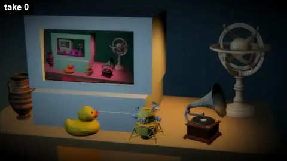

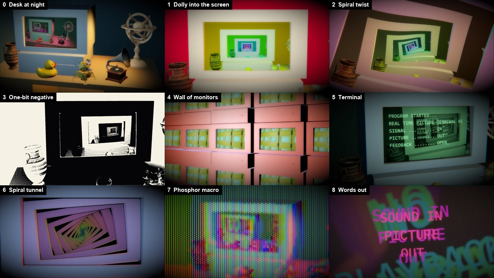

- **0 Desk at night**: A three-quarter view of the whole desk in a blue room with a warm pool of lamp light on the objects and a rainbow tunnel on the screen.
- **1 Dolly into the screen**: A head-on view of a brightly lit room with a red wall, where the camera travels into the screen and seamlessly re-emerges every two bars.
- **2 Spiral twist**: The head-on picture is bent into a continuously zooming spiral in which the nested monitors wind around the centre, lit in amber and blue.
- **3 One-bit negative**: A closer view from the left in pure black and white, where each nested copy inverts the one before it and every kick flips the whole frame.
- **4 Wall of monitors**: The desk is gone and fifteen stacked monitors, lit in salmon and blue, all show the same view of the wall, with the colours jumping on kicks.
- **5 Terminal**: A close view of a dark green screen where a short message types itself out and repeats down the nested copies a few frames apart.
- **6 Spiral tunnel**: The screen fills most of the frame and each nested copy is turned a little more, with extra turn from the bass, making a twisting corridor of monitor frames in pink and blue.
- **7 Phosphor macro**: An extreme close-up of the screen itself, broken into red, green and blue stripes and slowly panning, with the nested monitor only just readable.
- **8 Words out**: There is no room, only the feedback loop running outward, so a short amber phrase drawn in the centre on each beat flies toward the viewer while changing colour.

### Exploded technical drawing

`sc_exploded_view` · 3D models of unexplained objects are drawn as engineering line art: a shader traces outlines and creases, the objects come apart, and live dimension lines and labels sit around them.

**Follows the music:** Each kick snaps the parts further apart or closer together, and the parts of a lunar lander fly out on the bar line and land one by one through the bar. Snares drop a rubber stamp, the beat thickens the lines, and a new section of the song swaps the object.

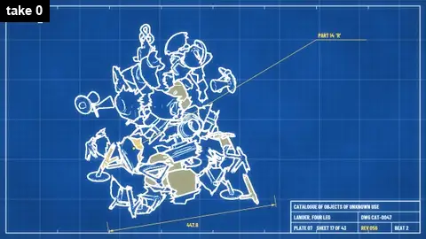

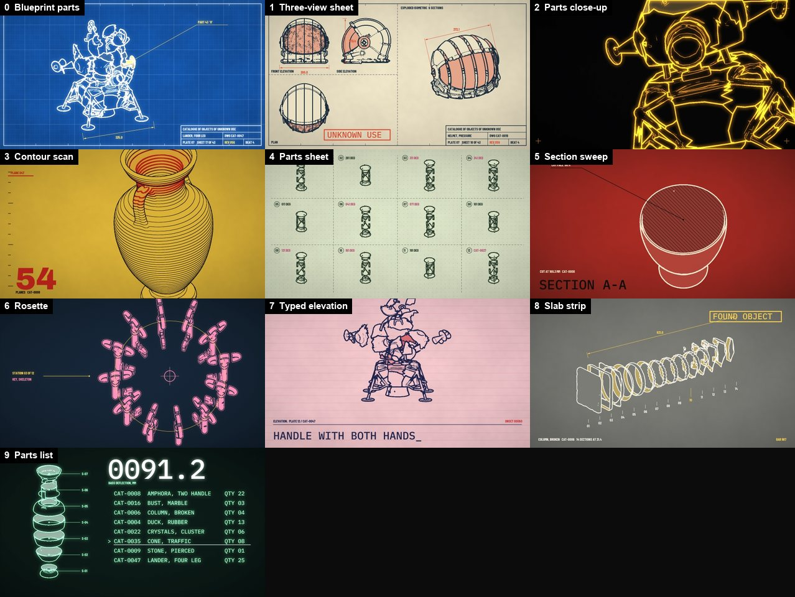

- **0 Blueprint parts**: A lunar lander in an angled view on blueprint blue with white lines, its 63 parts exploding outward and landing again from the ground up while a phrase is typed along the top.
- **1 Three-view sheet**: Cream drafting film with dark and red ink, showing front, top and side views of one object beside an exploded sliced version with hatched cut faces.
- **2 Parts close-up**: A close perspective view in among the lander's parts in amber on black with a soft glow and no lettering, each part lit solid as it lands.
- **3 Contour scan**: One huge cropped object on yellow drawn only as black rings where cutting planes meet its surface, with the kick setting the ring count and a red band scanning across once a bar.
- **4 Parts sheet**: Twelve small views of one object in a turntable grid on green dot-grid paper, the cells opening and closing with the beat and marked with balloon numbers.
- **5 Section sweep**: One huge object on red with its near end cut away and the cut face hatched in black, the cut plane jumping to a new depth on each kick.
- **6 Rosette**: Twelve copies of one sliced object arranged on a wheel as solid pink shapes on navy, the wheel clicking round one step per beat and bursting outward with the kick.
- **7 Typed elevation**: The lander seen square on from the front on a pink ruled slip in navy ink, its parts scattered and set back over two bars with the phrase in large type along the bottom.
- **8 Slab strip**: One object cut into up to fourteen numbered slabs laid out across a grey frame in white line with yellow hatching and one long dimension line.
- **9 Parts list**: A green-on-black screen where a parts list is the picture, with a huge live number and a tall exploded stack of slabs at one side joined to it by leader lines.

### Melting poster datamosh

`sc_flow_mosh` · A deliberate video-compression glitch: a clean picture flashes for an instant, then its own hidden motion drags blocks of the last frame around until the next clean flash.

**Follows the music:** Each kick drum snaps the clean picture back, fully on strong kicks and in ragged patches on weak ones, while snares restore about a third of it and break the smear into bigger tiles. Louder passages smear faster, vocals add vertical streaks and a red and blue colour split, and a new section of the song prints the next picture as a ghost over the old one before it snaps in on the beat.

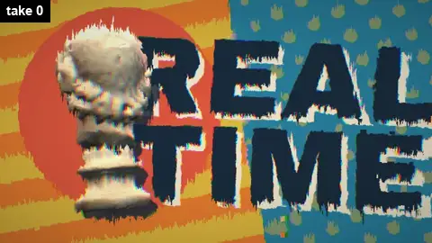

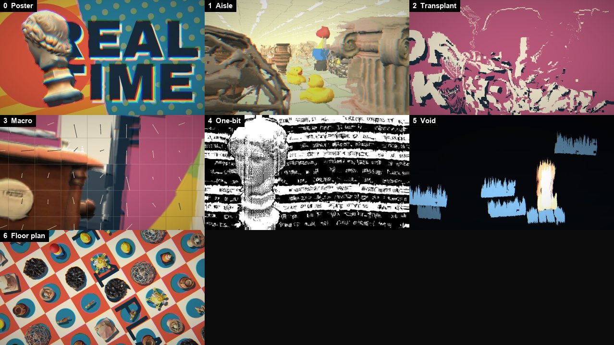

- **0 Poster**: The original look: a bold wordmark, one lit 3D model turning on a disc and flat colour fields, shown clean on the kick and melting in between.
- **1 Aisle**: A sideways tracking shot with no text through rows of objects standing on carpet tiles under strip lights, where near ones smear faster than far ones.
- **2 Transplant**: The clean frames are a big off-centre card of bold type, but the motion comes from a huge turning model that is never shown, so the lettering gets carved into the model's shape.
- **3 Macro**: A fast five-times zoom into the glitched picture with a grid of blocks and a motion arrow drawn on each one, turning letters and dots into huge torn shapes.
- **4 One-bit**: Pure black and white: rows of phrases slide in opposite directions with a dithered model punched through, and new pictures arrive as a scan from the top.
- **5 Void**: A nearly black frame with a small object, a caption and five floating tubes in one hot colour, where every light thing grows into a rising column until a strong kick clears it.
- **6 Floor plan**: The same field of objects seen from straight above on checkered tiles, with a phrase painted across the floor and a camera that turns with the bar and drops in.

### Ink in water

`sc_fluid_ink` · A two-dimensional fluid simulation in shaders, where words, pages of small print and 3D model silhouettes are laid down as three inks and lit like a wet surface over paper.

**Follows the music:** Kicks fire jets that carry a drop of ink, snares spin up pairs of vortices, hi-hats add fine droplets and the bass slowly stirs the whole tank. The voice is a moving nozzle that squirts ink at a height that follows the sung pitch, and each new section of the song stamps a fresh shape in a new place.

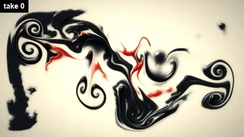

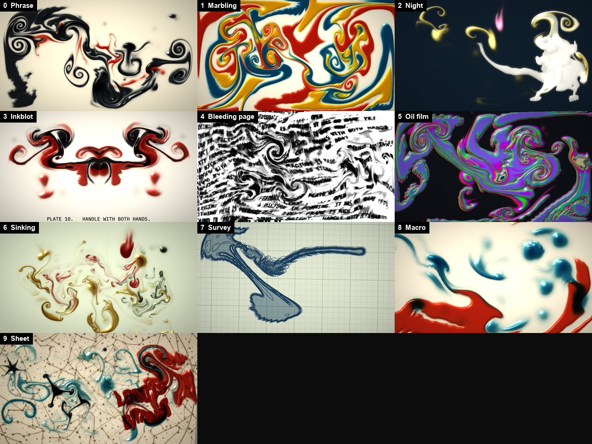

- **0 Phrase**: A poster phrase in glossy black ink sits off-centre in cream water, and each kick bursts as a red star of jets.
- **1 Marbling**: The whole frame is filled with red, yellow and blue bands, with no word at all, combed into marbled paper by jets from the edges.
- **2 Night**: A single 3D model appears as glowing ivory ink in dark navy water, with pink jets from the frame edges and yellow snares.
- **3 Inkblot**: Half the tank is mirrored down the middle like a folded inkblot test plate, with black blots and one red on white card above a typed caption.
- **4 Bleeding page**: A full page of small print bleeds away in pure black and white dots, sometimes inverted to white on black, and is printed again on every bar line.
- **5 Oil film**: A phrase larger than the frame floats as an oil film on black water, so its colour comes from the thickness of the film and shifts in rings as it thins.
- **6 Sinking**: Seen from the side, a row of three small model silhouettes at the top sinks as plumes while kicks fall as red drops from above.
- **7 Survey**: One model is drawn only as contour lines of ink thickness on green graph paper, with no gloss and barely any fill.
- **8 Macro**: Letters three times the height of the frame leave only fragments in view, in thick red, yellow and blue inks that mix under a strongly rippled surface.
- **9 Sheet**: A printed star chart lies under the water and bends with every ripple, with a small red stamped phrase on it, black kick stars and blue ink from the voice.

### Pictures made of type

`sc_glyph_render` · A 3D scene is redrawn from letters of one bitmap font in pure black and white, with brightness deciding how each letter is inked while the letters spell running sentences.

**Follows the music:** The text advances two characters on every beat, the snare flips the whole frame to its negative, and the kick swells the model and flashes the big word white. Louder bars use smaller letters, and hi-hats scatter stray characters through the sentences.

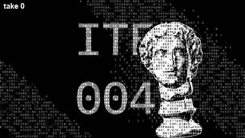

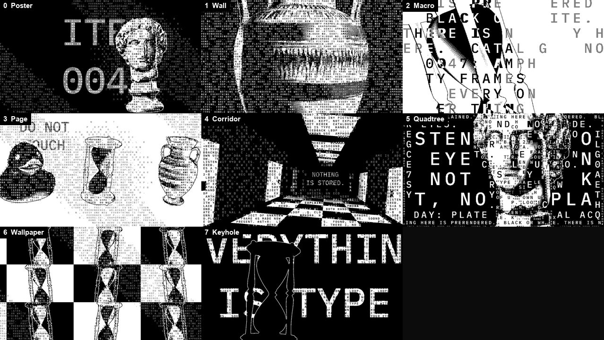

- **0 Poster**: One lit model stands to one side of a black frame with a large grey block word behind it.
- **1 Wall**: The whole frame is small type with every row scrolling as its own ticker in alternating directions, and an oversized model appears only as a negative silhouette.
- **2 Macro**: The camera sits very close to the model and tilts, so a few giant chunky letters lie over an abstract shaded surface.
- **3 Page**: A white page with black type shows three different models side by side from above, with a small word as a header at the top left.
- **4 Corridor**: There is no model here, only a corridor drawn in type with ceiling tubes, a checker carpet, doors and a small word on the far wall.
- **5 Quadtree**: Letter size is chosen block by block from local contrast, so huge letters fill the empty areas and tiny ones trace the edges of a large cropped model.
- **6 Wallpaper**: The picture repeats as a grid of three to five tiles a side, alternate tiles mirrored and in negative, and the checker pattern swaps on each beat.
- **7 Keyhole**: The picture exists only inside a giant cropped word, with the model as a black hole outlined in white and the surroundings filling with grey type on kicks and beats.

### Letter architecture

`sc_kifs_office` · A single ray-marched shader draws an endless folded fractal lattice of steel blocks, with sign lettering embossed into its surfaces as real relief that catches light.

**Follows the music:** Bass and vocal pitch change the fold angles so each note reshapes the building, the bar line opens the gaps between blocks, and every kick sends a pulse of light travelling through the space. Snares make the red lettering flare, hi-hats knock lights out or flash random blocks, and the camera never stops moving.

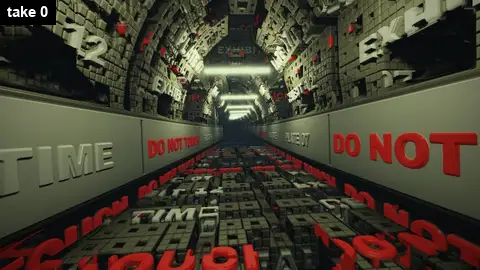

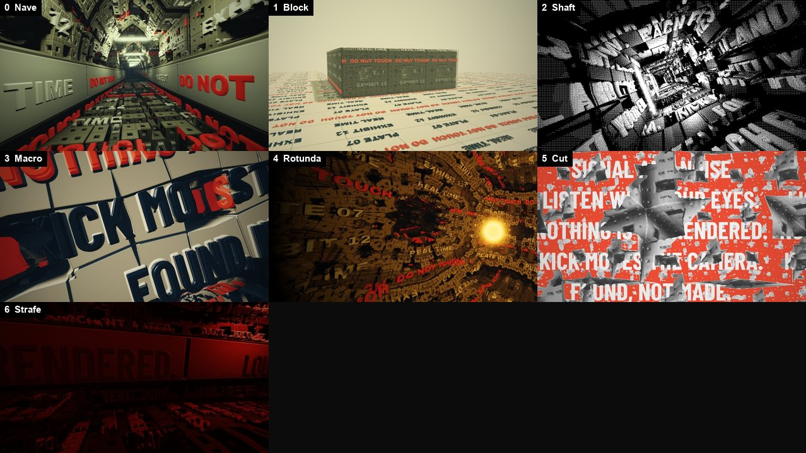

- **0 Nave**: A flight down an arched corridor under fluorescent tube lights in fluorescent green, with a steel band of whole readable sign words on both walls and occasional power cuts where only the red lettering glows.
- **1 Block**: The view moves outside into daylight, where a finite chunk of the lattice stands like a dark monolith on an endless cream printed sheet under a beige sky.
- **2 Shaft**: A plunge down a square shaft lined with huge extruded phrase letters and square ring lights, drawn in dithered 1-bit black and white that flips to its negative on the snare.
- **3 Macro**: An extreme close-up skims sideways over a sliced plate where ink-blue and red letters stand up off ivory tiles under a low raking sun.
- **4 Rotunda**: The camera sits inside a sphere carved from a more strongly folded lattice, where a glowing amber orb at the centre throws radial shadows over a dome of words, amber on black.
- **5 Cut**: A flat, poster-like view square onto a diagonal slice through the lattice, with the cut face painted red, phrases knocked out in white, and soft white clay showing through the holes.
- **6 Strafe**: The corridor again but in red emergency lighting, travelling sideways along the wall like a train window while one phrase at a time passes and alternate tube lights strobe on the beat.

### Kinetic type machine

`sc_kinetic_type` · Moving poster typography in flat colours: every letter, rule and bar is its own small rectangle cut from a font sheet, placed and animated by a shader.

**Follows the music:** The beat steps the scrolling lines, typing, word changes and giant counting numerals, while kick drums jolt and scatter the letters, snares flip the colours and hi-hats light up single letters. Louder passages open the layouts up, and each new section of the song swaps in another phrase and arrangement.

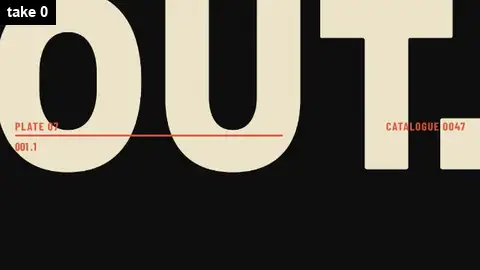

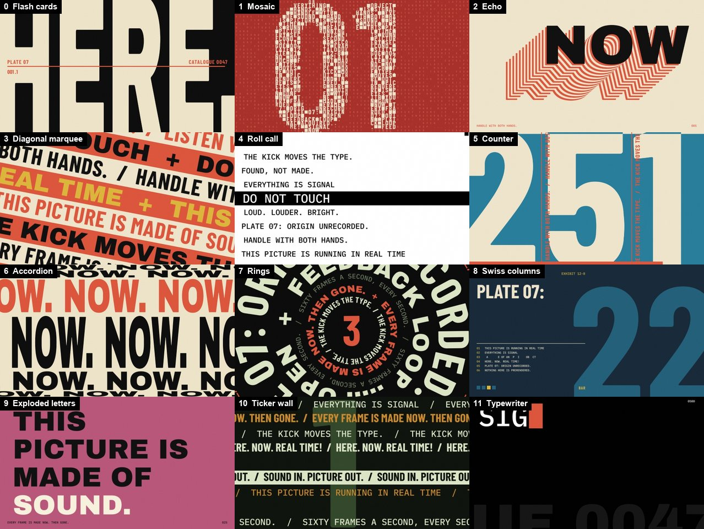

- **0 Flash cards**: One heavy word per beat, stretched to fill most or all of the frame, with the snare flipping the card to its negative.
- **1 Mosaic**: A full-frame field of small letters with text streaming through it, where the cells under a giant counting numeral swell and darken and kicks shake the numeral apart; there is no headline.
- **2 Echo**: One or two big words with a stack of copies behind them in alternating colours, like a striped extrusion that stays tight in quiet beats and shoots out on kicks.
- **3 Diagonal marquee**: Tilted bands of scrolling phrases in two typefaces running in opposite directions at different speeds, with the tilt jolting on the snare.
- **4 Roll call**: A black and white list of phrases that steps up one line per beat through a white bar that enlarges the current line, with kicks jolting alternate lines apart.
- **5 Counter**: Three giant counting numerals filling the frame edge to edge, with thin columns of text running vertically between them and an inverted area rising over two bars.
- **6 Accordion**: Rows of a repeated word scrolling in alternating directions, squashed and stretched as a bulge of height travels through the rows once a bar.
- **7 Rings**: Phrases set around concentric circles, each ring with its own size, typeface, speed and direction, usually centred off the frame so the type crosses it in arcs.
- **8 Swiss columns**: A grid layout with a bar number as tall as the frame beside a headline that types itself out above a rule and a small numbered list.
- **9 Exploded letters**: A sentence holds together for one bar, then every letter jumps to its own cell of a coarse grid, turned and rescaled, before assembling again.
- **10 Ticker wall**: Nine to eighteen rows of scrolling phrases at different speeds and directions over one huge beat numeral, with an inverted band sweeping across each bar.
- **11 Typewriter**: A sentence typed one character per sixteenth note in a large fixed-width face with a block cursor, filling the frame over a huge cropped catalogue number scrolling behind.

### Fog and shadow type

`sc_light_gobo` · A dark room full of drifting fog, lit by a projector, fluorescent tubes and a lamp, where patterned light and the shadows of objects hang as solid shafts in the air.

**Follows the music:** Kick and snare hits strike the fluorescent tubes and kick the projector brighter, while the bass and kick make the fog thicken in puffs. The beat moves the patterns in the light, the bar slowly sweeps the projector, and each new section of the song changes the projected phrase.

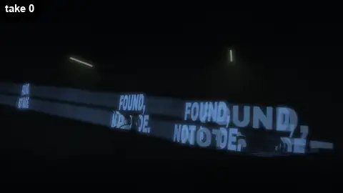

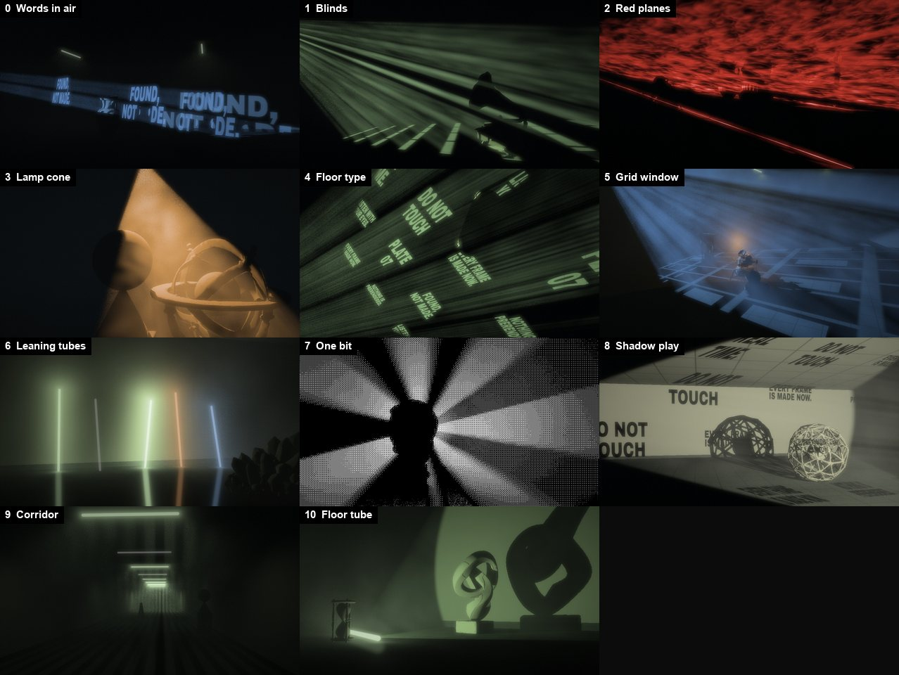

- **0 Words in air**: A blue projector beam seen at an angle, with a phrase repeated on layers of smoke that recede to the wall and an amphora cutting its shadow out of each copy.
- **1 Blinds**: Green light through venetian blinds, seen side-on so each shaft is a hard diagonal blade, with the slat pattern on the carpet and a backlit gramophone.
- **2 Red planes**: No beam at all: a comb of thin red planes of light, each showing a swirling slice of the smoke, with a row of objects as a black skyline below.
- **3 Lamp cone**: A close-up of one warm cone of lamp light with smoke curling in it over an astrolabe and a stack of solids, and everything else black.
- **4 Floor type**: Seen from straight above, tiled phrases are thrown across the carpet at a raking angle, with the long shadows of a pierced stone and a traffic cone.
- **5 Grid window**: A wide, high view of a ruled grid thrown as planes of blue light over a big dark floor, with a small lander under a warm lamp and ceiling tubes above.
- **6 Leaning tubes**: No projector: bare tubes in green, blue and one warm colour lean on a wall and mirror in a polished floor, with a crystal cluster in silhouette in front.
- **7 One bit**: The whole picture reduced to black and white dots, with a spoked wheel of light turning behind a bust's silhouette and its shadow coming at the camera.
- **8 Shadow play**: The negative of the others: a bright paper-coloured room printed with dark phrases over wall, floor and ceiling, with a turning wire cage and its shadow.
- **9 Corridor**: No projector: ceiling tubes recede down a long narrow corridor and a pulse of light races toward the camera every two beats, past a stack of solids and a traffic cone in silhouette.
- **10 Floor tube**: A close-up at carpet level, where one green tube lying on the floor beside a small hourglass throws a looped ribbon's giant shadow up the wall.

### Paper storm

`sc_paper_storm` · Thousands of copies of a printed sheet of paper, plus a couple of hundred objects, are each placed and turned by one shader that arranges them into different formations.

**Follows the music:** The bar turns the formations and the beat flips sheets, changes pages and steps the falling paper. Each kick drum throws things outward and sends an amber shockwave ring through the paper, while overall loudness brightens the lamp and glow.

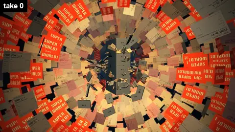

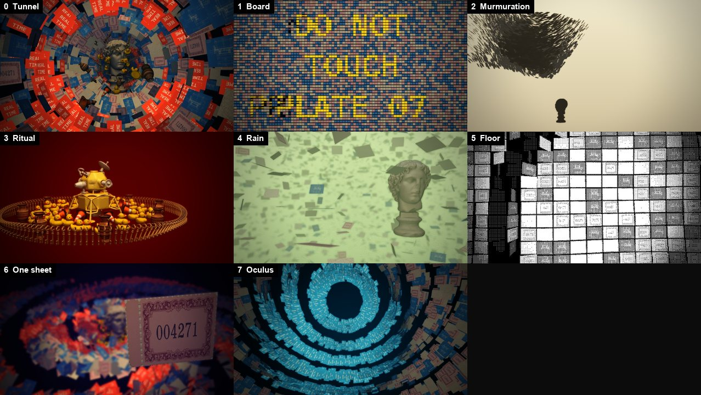

- **0 Tunnel**: A flight down a tube of printed sheets (blueprints, star charts and pink tickets) towards a marble bust in a dark void, with a ring of sheets flipping to a red reverse on each beat.
- **1 Board**: A flat wall of sheets seen square-on, where sheets turned to their yellow reverse spell short three-line phrases in pixel letters and a new phrase flaps in every two beats.
- **2 Murmuration**: The sheets become dark silhouettes folding like a flock of birds in a pale cream sky, with the bust small beneath them and no readable text.
- **3 Ritual**: No paper at all: rings of rubber ducks, a fence of brass keys that fall like dominoes, traffic cones and amphorae turn around a gold lunar lander on a red background, seen low and close with soft focus.
- **4 Rain**: A fixed camera in pale green haze watches sheets fall like leaves past a marble bust, one step per beat, with the nearest ones out of focus.
- **5 Floor**: A view straight down on a tidy floor of printed sheets drawn in chunky black-and-white pixels, where a ring of sheets turning to black spreads out every two beats.
- **6 One sheet**: A single large sheet turns close to the camera, sharp and readable, while the whole swirl of paper is a red and blue blur far behind it.
- **7 Oculus**: A view from inside a dome looking up through rings of paper turning against each other, whose blue reverses carry a short phrase.

### Slime mould

`sc_physarum` · A slime mould simulation: about 230,000 tiny agents follow each other's trails and grow veins over turning 3D objects, printed sheets and short phrases.

**Follows the music:** Bass sets how coarse the vein mesh is, vocals make it more cellular, and drums and overall energy speed the agents up. Each kick scatters a share of the agents, each snare briefly makes them flee what they were tracing, and a new section of the song swaps the subject so the veins abandon it and find the next one.

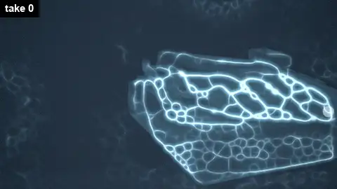

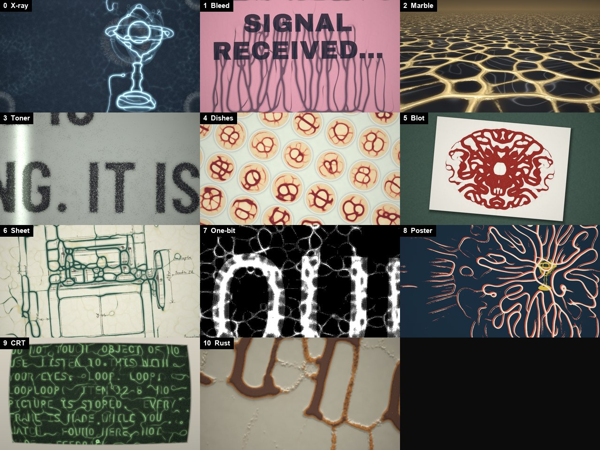

- **0 X-ray**: A large turning object sits off-centre and is traced in fine lace, like blue X-ray film on a lightbox.
- **1 Bleed**: A phrase at the top of a coloured sheet runs downward in merging rivulets of ink, so this take is a flow rather than a network.
- **2 Marble**: With no subject at all, gold veins spread through black marble seen as an endless floor at a low angle while the camera travels over it.
- **3 Toner**: The agents leave no trail and are drawn as loose toner specks on copier glass, packed onto a block of phrases that kicks blow to dust.
- **4 Dishes**: A grid of walled petri dishes on a light table each grows its own red culture, giving many small subjects instead of one.
- **5 Blot**: A folded, mirrored inkblot in red or black ink sits on a card on a green blotter and spatters on kicks.
- **6 Sheet**: Seen from directly above, teal mould starts from a few blots and follows the printed lines of a paper sheet: a star chart, a machine drawing or a ticket.
- **7 One-bit**: A fragment of a word larger than the frame is drawn in coarse black-and-white dither that flips to negative on snares.
- **8 Poster**: A tiny yellow object sits in a wide navy field and the colony bursts out of it, printed in three flat screenprint inks.
- **9 CRT**: A wall of small text on a curved green monitor in a beige case is eaten away line by line into bone-like letters.
- **10 Rust**: An extreme close-up shows rust spreading under blistering putty-coloured paint, with only a few letter strokes crossing the frame.

### Point cloud shapeshifter

`sc_point_morph` · One cloud of about 124,000 coloured points, sampled from the surfaces of 3D models and lettering, that streams from one shape into the next on a noise wind.

**Follows the music:** Each new section of the song sends the cloud flying into its next shape, and every beat sweeps a bright band up through it. Kicks make the surface jump and throw light outward, bass swells the whole body, and vocals make scattered points shimmer.

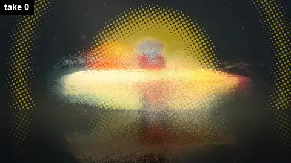

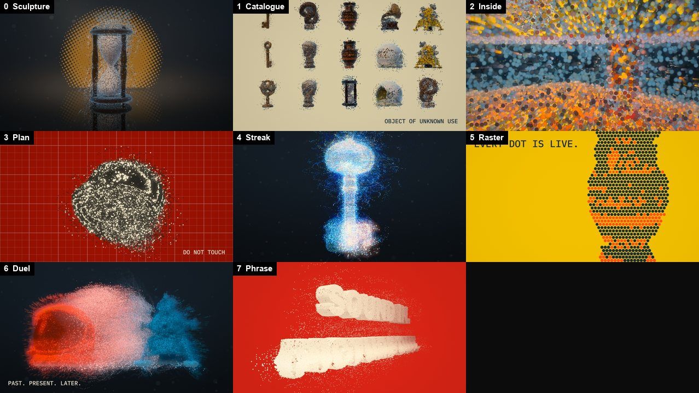

- **0 Sculpture**: A single object or phrase in its real colours stands on a reflecting floor in front of a sun made of print dots, seen by a slowly swinging camera.
- **1 Catalogue**: Fifteen small clouds sit in a five by three grid on flat paper, a different model in each cell, while the beat steps a highlight from cell to cell.
- **2 Inside**: The camera stands inside a model enlarged five times and looks out through its skin, so the picture becomes a wall of coloured discs rather than an object.
- **3 Plan**: The object is seen from straight above and drawn only as contour lines on a drawing grid, with a bright contour climbing it on each beat.
- **4 Streak**: Only a small fraction of the points are kept while the model spins fast in the dark, so each point drags its orbit out into a long line like a long exposure.
- **5 Raster**: The object is redrawn as a print screen of big flat discs in two inks on coloured paper, cropped close and off-centre with a line of type.
- **6 Duel**: Two objects in two different inks stand side by side, seen from near the floor, with a strand of points continually pulled out of one and into the other.
- **7 Phrase**: A short phrase is treated as a landscape in one pale ink on coloured stock, the camera raking along the letters from one end as the far end fades into the paper.

### Living rubber stamp

`sc_rd_stamp` · Stamped phrases feed a reaction-diffusion simulation, so the letters grow coral-like tendrils and beads, lit as raised gold, red enamel or black tar ink on printed paper sheets.

**Follows the music:** Each kick drum presses the letters solid again, and between kicks they hollow into outlines, worms and beads; a new song section brings a new phrase and ink. Louder, bassier passages let the growth spread further from the letters, snares burn it back, and high hits make the ink glint.

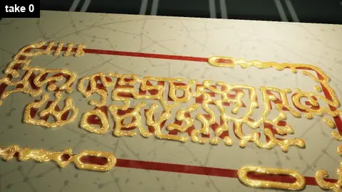

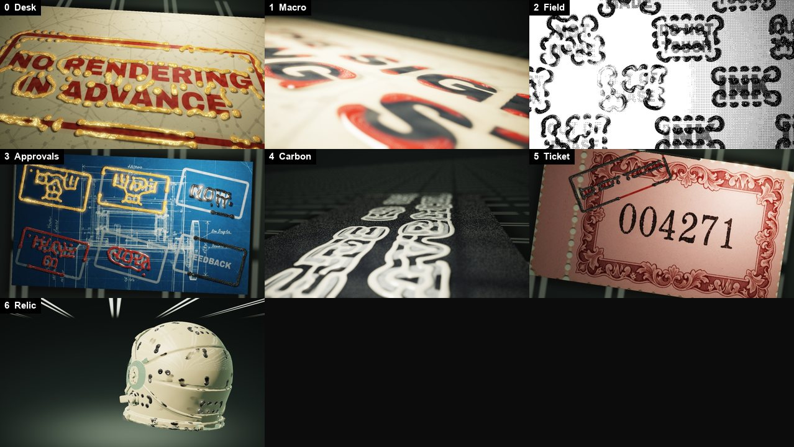

- **0 Desk**: A tilted cream star chart with one framed phrase stamped on it, seen wide and then slowly closing in, with the ink changing between gold, red and black by song section.
- **1 Macro**: The same paper from a few centimetres up with shallow focus, so the edge of the ink becomes a landscape and no word can be read.
- **2 Field**: No page at all: seen from above, the whole frame is twelve short words dissolving into worms, in dithered pure black and white.
- **3 Approvals**: A blueprint seen from straight above with six small crooked stamps in gold, red and black, and each kick presses about a third of them again.
- **4 Carbon**: A negative version with white ink on dark carbon paper, where an oversized unframed phrase is seen from one end like road markings, in shallow focus.
- **5 Ticket**: A pink admission ticket from above, where one small black stamp lands somewhere new on every kick and leaves its red impressions behind.
- **6 Relic**: No paper: the same living ink is wrapped around a 3D object (an amphora, a pierced stone sculpture or a space helmet) turning in the dark.

### Misregistered print shop

`sc_riso_press` · A 3D object lit by red, green and blue lights is split into spot-colour plates, each screened into dots, lines or grain and overprinted out of register on moving paper.

**Follows the music:** Kick, snare and hi-hat each re-expose their own plate and knock it out of register before it springs back, while the bass swells the dots and lines. The paper advances on the beat or the bar, and each new section of the song changes the object, the words and the inks.

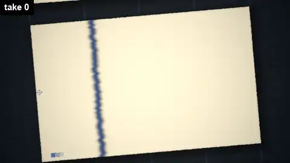

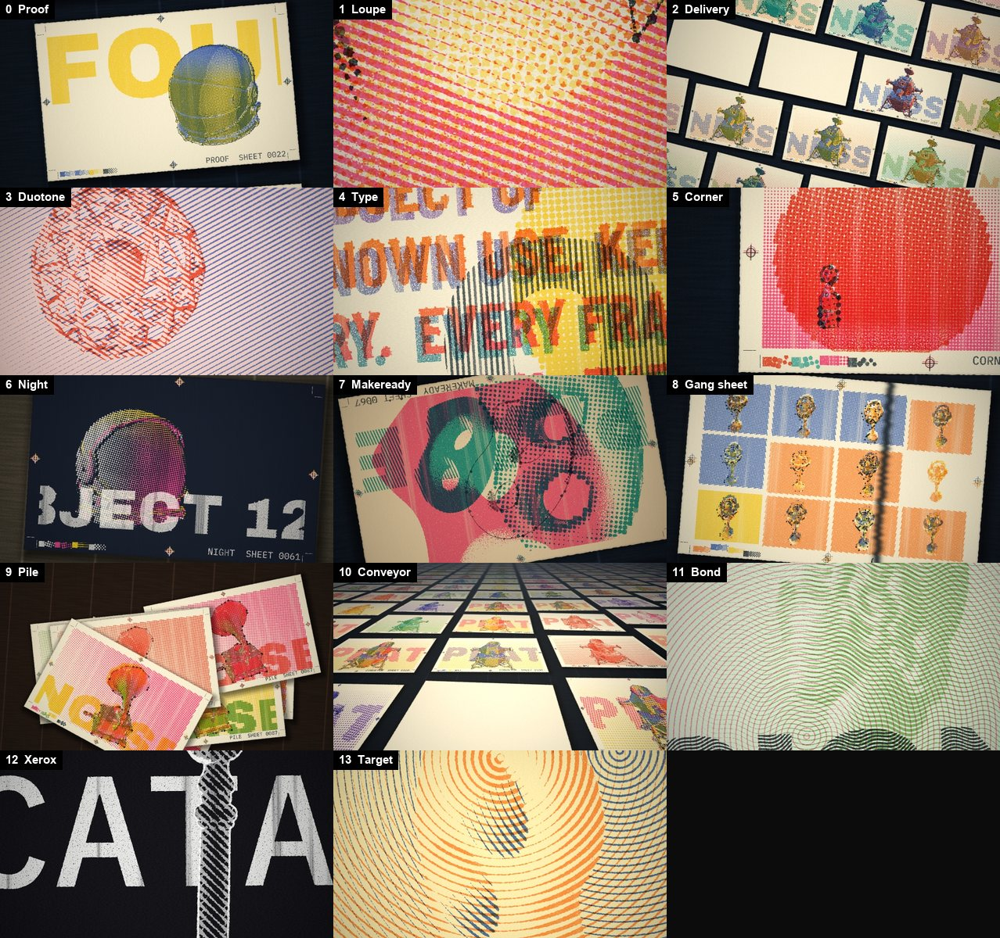

- **0 Proof**: One printed sheet nearly fills the frame, with the object on the right, a huge cropped yellow word, and printer's marks around the edge.
- **1 Loupe**: An extreme close-up of the print screens, showing giant dots, lines and grain with colour fringes where the plates miss each other, and no readable word.
- **2 Delivery**: Seen from high above, lanes of small sheets run in opposite directions, with a new sheet every beat and each sheet in its own colours.
- **3 Duotone**: Just two inks, red and blue, printed as line screens that cross into a moire pattern on pink paper, with the object seen from above and the print running to the edges.
- **4 Type**: No object at all: rows of phrases in pink and teal slide past each other over a coarse yellow disc and a striped fragment of a big word.
- **5 Corner**: The bottom-left corner of a poster, with a sun made of coarse dots, a tiny object, and the register crosses and colour bar large in the frame.
- **6 Night**: Opaque white, pink and yellow inks on dark navy paper, printed where the light falls instead of in the shade, with a white outlined word.
- **7 Makeready**: A waste sheet lying upside down on brown paper, where every plate carries the object at a different size and angle.
- **8 Gang sheet**: The artwork is repeated in a grid of four by three on one sheet, each tile printed with its own mix of inks.
- **9 Pile**: On every beat a finished sheet is slapped onto a heap on a brown table, each landing at its own angle.
- **10 Conveyor**: A low, tilted view down the press bed, with lanes of sheets stepping toward and away from the camera each beat and fading into haze.
- **11 Bond**: Banknote-style printing on green-grey paper, where wavy engraved lines draw the object and a big word over a faint pink ring pattern.
- **12 Xerox**: A black-and-white photocopy look with a cross-hatched object, a big typewriter-style word and heavy streaks, where every second copy is a negative.
- **13 Target**: Orange and blue screens made of concentric rings with different centres overlap into bullseye moire on yellow paper, with the object enlarged.

### Scan line video synth

`sc_rutt_etra` · A 1970s-style analogue video synthesizer: a hidden source picture is redrawn as glowing scan lines in 3D, each line pushed up and back by the brightness beneath it.

**Follows the music:** Bass bends the whole picture sideways, kick hits make the lines stand taller and flash, and snare hits tear bands of lines sideways. Hi-hats break the lines into gaps, the live spectrum ripples along them, and each new section of the song turns the picture to a new angle and rolls it once.

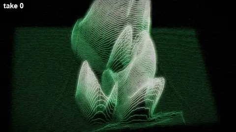

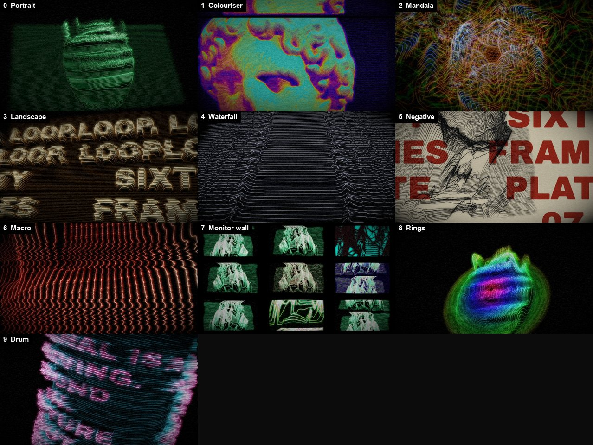

- **0 Portrait**: A 3D model drawn as a green wire relief on a tilted plane, seen from a three-quarter view; the classic look of the technique.
- **1 Colouriser**: Hundreds of fine lines seen face-on and close up, almost a solid picture, with brightness split into hard bands of flat colour and the picture slipping vertically on the bar line.
- **2 Mandala**: Two dozen lines made from plain oscillators are fed back on themselves like a camera pointed at its own monitor, building a mirrored pattern with three to eight-fold symmetry.
- **3 Landscape**: No model: printed phrases fill the frame as raised amber wire lettering on a plane laid back like terrain.
- **4 Waterfall**: No picture at all: the last few seconds of the music's spectrum are drawn as a white mountain range, with nearer ridges hiding the ones behind.
- **5 Negative**: The polarity is reversed, giving dark wires of a model on a lit beige field with a phrase printed flat in red behind them, set off-centre.
- **6 Macro**: A few dozen fat red lines running vertically in extreme close-up, with nearer lines hiding those behind, so the subject reads as abstract.
- **7 Monitor wall**: The same signal shown on a bank of four, nine or sixteen small screens, each set up differently in colour, brightness, zoom and stability.
- **8 Rings**: The scan lines are bent into concentric circles, each ring its own hue, giving a rainbow relief of the model on black.
- **9 Drum**: Phrases are raised around a slowly turning cylinder of cyan rings with pink lettering, tilted and off-centre.

### Shatter and reassemble

`sc_shatter` · 3D models and extruded phrases are pre-cut into rigid shards, and a shader bursts them apart and pulls them back together exactly, like footage run backwards.

**Follows the music:** Each bar bursts the object apart and pulls it back so it locks together on a bar or beat line, with louder passages throwing the shards further. Kick drums crack the object open for a moment, vocals brighten the glow inside the cracks, and a new section of the song swaps in a different object.

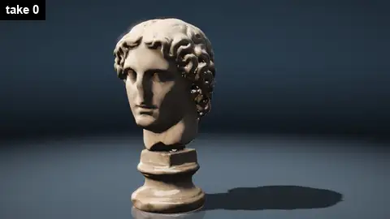

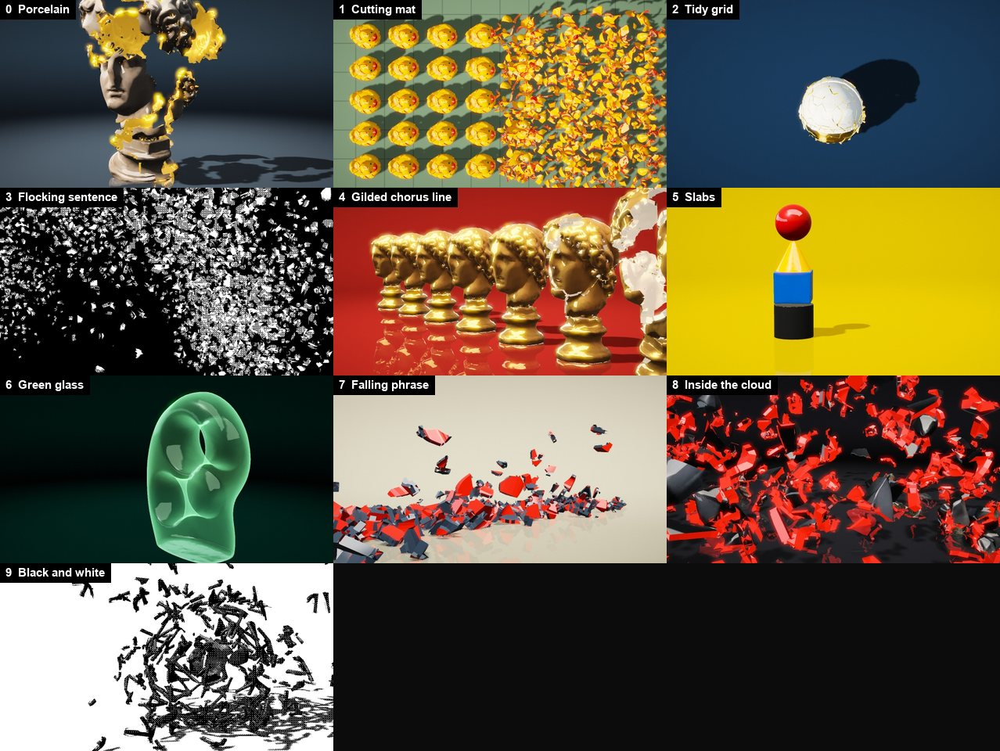

- **0 Porcelain**: One statuette (a marble bust, an amphora or a pierced stone) seen close in a dark blue room breaks into a few big pieces that drift apart from an impact point and close on every bar, with the cracks glowing gold from inside.
- **1 Cutting mat**: Forty rubber ducks or forty amphorae lying on their sides are laid out on a green cutting mat and seen from straight above while a wave of detonations crosses the grid, showing red insides and hard shadows.
- **2 Tidy grid**: Instead of exploding, one object (a gramophone, a space helmet, a lander, an astrolabe, an hourglass or a traffic cone) takes itself apart into a neat grid of its own pieces lying flat on ink blue, then the pieces fly home.
- **3 Flocking sentence**: A sentence made of thousands of white chips on black, in pure black and white, swirls like a flock of birds and then locks into place from left to right.
- **4 Gilded chorus line**: A receding line of seven gilded busts on a red floor with reflections cracks open one after another down the line, showing plaster-white insides.
- **5 Slabs**: One object (a broken column, a stack of painted solids, a traffic cone or an hourglass) is sliced into horizontal slabs that slide apart from the top down, seen side-on through a long lens against flat yellow with blue insides.
- **6 Green glass**: The object becomes a ghost of green glass in the dark, visible only as glowing rims, glints and overlaps, while its shards drift apart and back.
- **7 Falling phrase**: A red phrase seen low and close from one end falls from the top down into a heap of blocks on cream, then rises back into place.
- **8 Inside the cloud**: The camera sits inside a slow, four-bar burst of chunky shards in a black room, with red insides and a wide lens.
- **9 Black and white**: One lit object and its shadow on white paper are reduced to pure black and white dots and move in twelve jerky steps per cycle, like stop motion.

### Spectrogram terrain

`sc_spectral_terrain` · A scrolling history of the last few seconds of the sound spectrum becomes a height map, drawn as a landscape of glowing ridge lines that recede from the viewer.

**Follows the music:** The frequency spectrum is the shape of the land itself, with the newest sound at the near edge, and each kick drum sends a bright swell rolling away, nudges the camera and flashes the standing words. The sung note sets the height of a ribbon of light, the bass note tints the horizon glow, and snare hits split the colours.

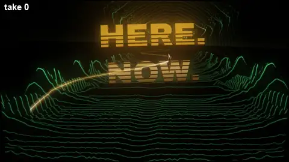

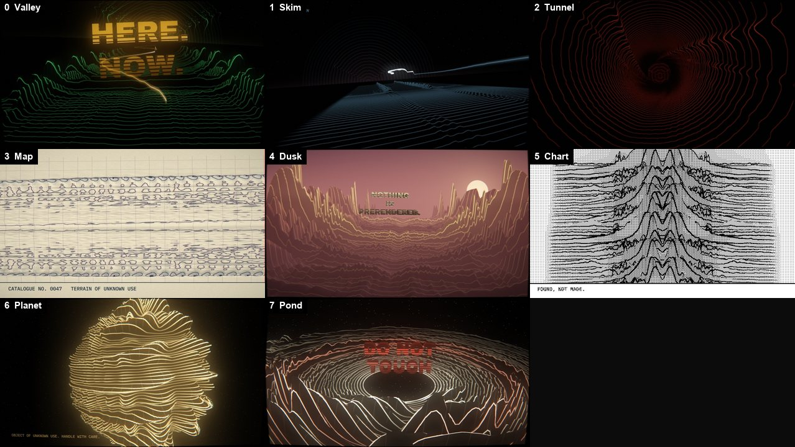

- **0 Valley**: The original view: a tall extruded phrase stands in a line-drawn valley under a sun made from the spectrum, in green and amber on an old-monitor screen.
- **1 Skim**: A low, wide-angle forward flight in ice blue with no standing phrase, where the rows of the landscape rush at the lens and a small text readout sits in the corner.
- **2 Tunnel**: The landscape is rolled into a red tube with the camera inside, rolling with each bar while kicks travel down it as white rings toward a round sun at the far end.
- **3 Map**: A daylight view straight down onto cream paper, where the land becomes ink contour lines with a blue height tint, kicks are stamped as red hatched bands and a title block labels the sheet.
- **4 Dusk**: Solid, lit mountains in pink fog under a small sun, with a phrase standing small and far away instead of the usual line drawing.
- **5 Chart**: No perspective at all: the rows are stacked flat like a seismograph trace in pure black and white dots with a caption, sometimes inverted or turned on its side.
- **6 Planet**: The landscape is wrapped around an amber globe turning in a field of stars, seen either whole or close along its edge, with kicks swelling a band around it.
- **7 Pond**: A spiral disc of cream ripples on black spreads outward from a red phrase at its centre, each kick leaving the middle as a new ring.

### Time-sliced objects

`sc_time_slab` · A slit-scan effect: a spinning 3D object is recorded for about a second, and every part of the picture shows a different moment of that recording.

**Follows the music:** Kick drums snap the prop round, pulse its size and throw parts of the picture further into the past, while snares make it nod and flash the rim light. Bass and overall loudness set how deep into the past the picture reaches, and the tempo drives the bounce, the sweeps and the crawl.

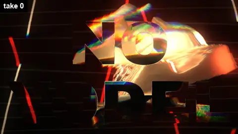

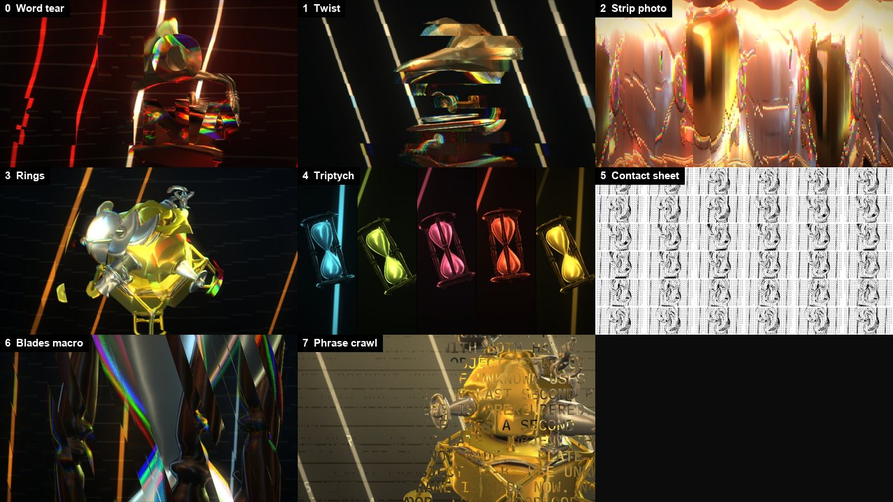

- **0 Word tear**: A prop sits off centre in a dark room and a giant phrase appears only as a tear in time across it, where the prop is a few frames older and turned differently.
- **1 Twist**: In an empty black room seen from a low camera, a smooth ramp of time is cut into slices so the fast-spinning prop becomes a stack of discs each turned a different amount, with no text.
- **2 Strip photo**: A scrolling canvas is fed from one thin vertical slit of the picture, so the turning prop is unrolled sideways into a long frieze that wipes across the ordinary view after each cut.
- **3 Rings**: Seen from high above, a large prop is cut by stepped rings of the past that leave an off-centre point on every beat, with kicks throwing alternate rings further back.
- **4 Triptych**: Three to five tall panels show the same view at evenly spaced moments of the last second, each under its own colour, and every kick moves the present one panel along.
- **5 Contact sheet**: A grid of small frames, each the whole picture a little older than the last, drawn in pure black and white dots and filling in cell by cell after a cut.
- **6 Blades macro**: A long lens close on part of the prop is cut by slanted blades of time with the widest colour fringes, reshuffled by every kick into abstract chrome and rainbow.
- **7 Phrase crawl**: Against a daylit beige wall, lines of small text crawl up the frame and act as the time pattern, so the words read as a texture across a large prop set to one side.

### Oscilloscope beam drawings

`sc_vector_scope` · A simulated oscilloscope tube: one glowing beam traces word outlines, 3D model wireframes and waveforms, with fading phosphor afterglow, soft glow and a measuring grid.

**Follows the music:** The raw left and right audio samples are added to the beam's position, so every drawing shivers and fattens as the track gets louder and is clean when it is quiet. Kicks make the picture swell, ring and brighten, hi-hats fatten the line, shapes change every 4 or 8 beats, and a new section of the song briefly bursts the drawing into scribble.

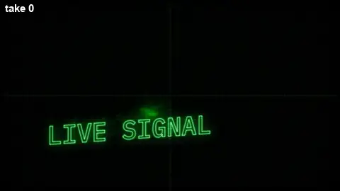

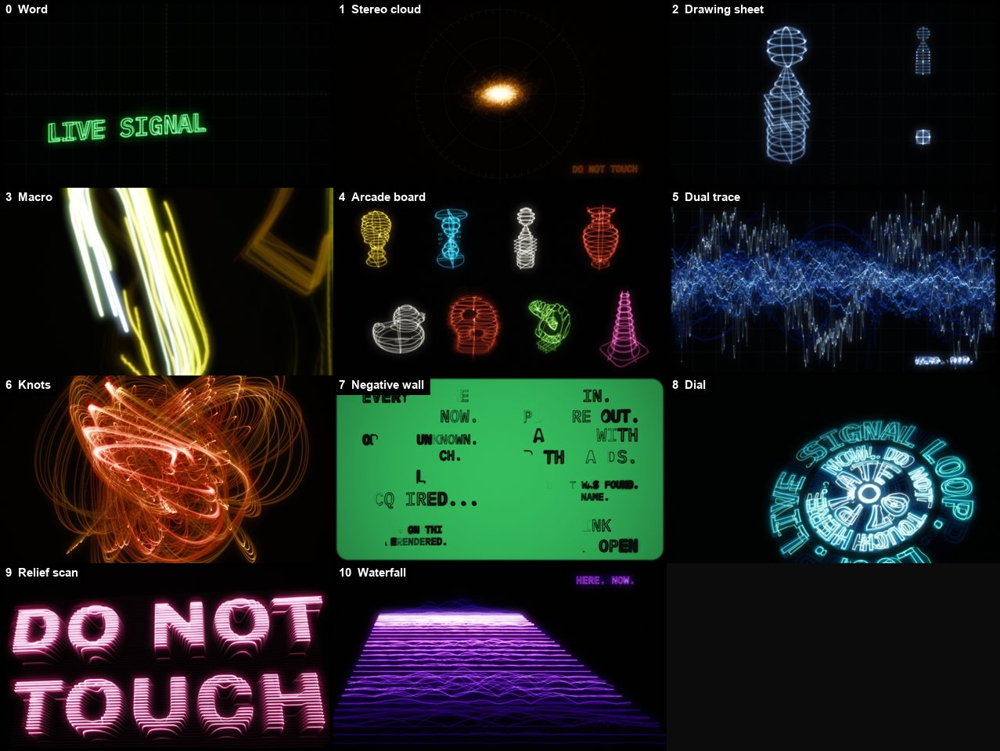

- **0 Word**: A single phrase drawn as a green outline low and off-centre on a grid, dissolving into the raw stereo waveform on every fourth beat before the next phrase forms out of it.
- **1 Stereo cloud**: The stereo sound itself fills the frame as an amber cloud on a circular grid, with only a small label word in one corner.
- **2 Drawing sheet**: A blue-white wireframe model turns in 3D on one side with its still front and top views small on the other, changing to a new model every 8 beats.
- **3 Macro**: An extreme close-up of a giant letter outline, shown as fat out-of-focus ribbons written by a travelling point with a blue flash and a long yellow afterglow, and no grid.
- **4 Arcade board**: Eight different wireframe models, each in its own colour, spin on a four by two board that reshuffles every bar, like a colour vector arcade screen.
- **5 Dual trace**: A classic swept scope view with the left channel's waveform above and the right channel's below, or the two overlaid, plus a small readout word.
- **6 Knots**: Four nested looping 3D knot figures shading from amber to red, whose proportions change every 8 beats.
- **7 Negative wall**: The picture is inverted: a lit green screen with eight blocks of text cut out of it in black, written in fragments by travelling points.
- **8 Dial**: Aqua phrases bent around three concentric rings that tick round one notch per beat in alternating directions, with a small circular waveform at the centre, larger than the frame and pushed to one side.
- **9 Relief scan**: Hot pink horizontal scan lines seen at a slant are pushed out of the screen by the brightness of a picture, which is either a lit turning model or a two-line phrase.
- **10 Waterfall**: A single violet waveform trace climbs away in steps while its long afterglow leaves the last few seconds behind as a ridged landscape, with a small readout word.

## Treatments

A treatment re-sees the shot's picture for as long as the shot lasts.

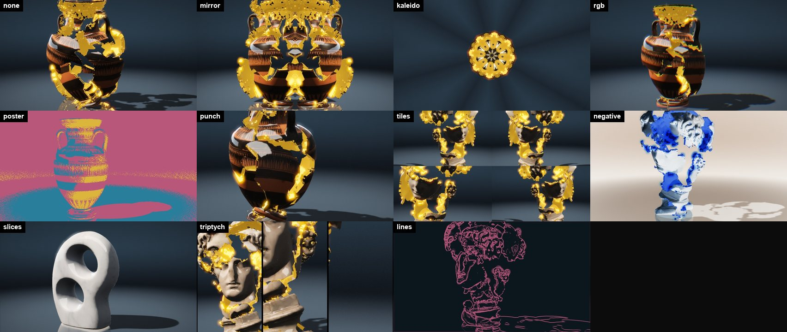

## Layers

Some shots run two scenes at once.

## Transitions

How a shot arrives over the last one (each caught part-way through).
